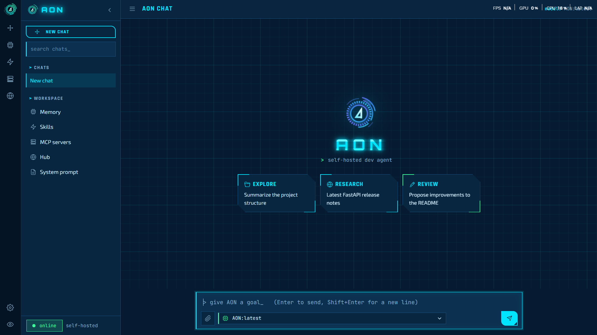
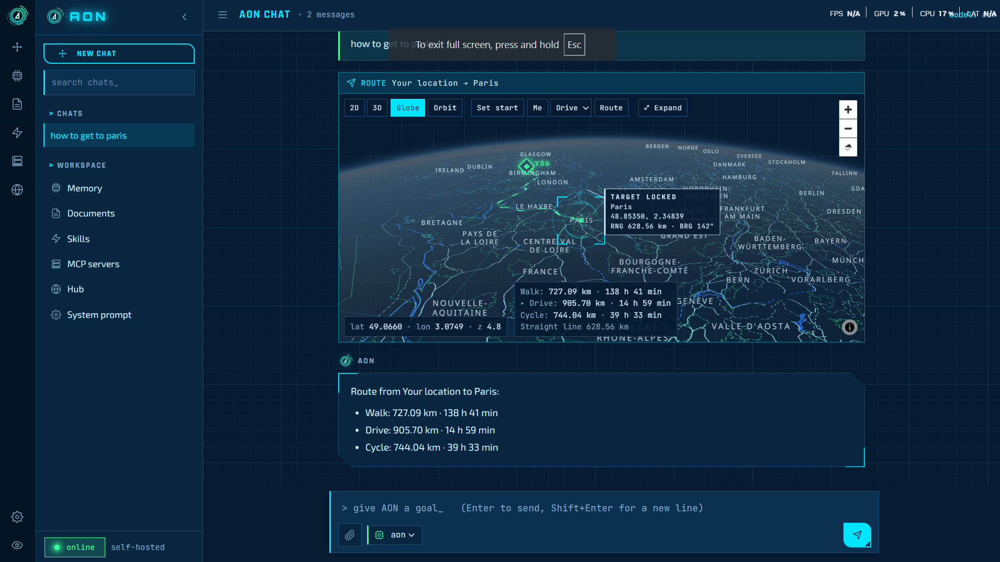

<div align="center">

# 🛰️ AON — a self-hosted AI agent

[](https://aon.vulkron.uk)
[](https://www.youtube.com/watch?v=wLiVhkLOd-8)


| 💬 Chat | 🗺️ Maps |
|:---:|:---:|
|  |  |

</div>

AON is a self-hosted chat agent that runs on your own hardware with local models. It answers
questions, runs tools in a workspace (files, shell commands, web fetch and search), remembers you
across chats, searches your own documents, and can be extended with skills and MCP servers. It
has a web UI (also usable on phones) and an optional Telegram bot.

> 🔒 Nothing is sent to a cloud LLM: chat runs on [Ollama](https://ollama.com) or
> [vLLM](https://docs.vllm.ai), embeddings on Ollama.

## 🎬 Demo

<div align="center">

[](https://www.youtube.com/watch?v=wLiVhkLOd-8)

▶️ *Click the image to watch on YouTube*

</div>

## 🔑 Trying the live instance

Access to the live instance is by approval only:

1. 📝 **Request access.** [Open an issue](https://github.com/leo007-htun/AON/issues/new?title=Access%20request)
   titled *Access request*, saying who you are and what you would like to use AON for. Please do
   **not** post your email address in the issue; the maintainer will reply and tell you how to send it.
2. ⏳ **Wait for approval.** Requests are reviewed by hand. Once yours is approved, your email address
   is added to the allowed list and the issue is closed with a note.
3. ✅ **Sign in.** Open <https://aon.vulkron.uk>, enter the approved email address, and type the
   one-time PIN that is emailed to you. The PIN sign-in is handled by Cloudflare Access.

Access can be withdrawn at any time. The instance runs on private hardware with limited capacity:
please do not use it for anything illegal, for automated or bulk traffic, or to process other
people's personal data, and expect a short wait when several people are using it.

## ✨ Features

- 🛠️ **Agent loop with tools**: read, write and edit files, run shell commands, fetch and search the
  web, show maps, remember facts. Commands and file writes ask for your approval first.
- 🧠 **Long memory**
  - **Episodic memory**: facts about you and your work, stored and searched by meaning; a
    duplicate or an updated fact is merged by the model.
  - **Chat recall**: older turns of a chat (and of your other chats) are found by meaning and by
    exact strings (IPs, codes, numbers) and added to the request.
  - **Rolling summary** of each chat, plus a numbered outline of everything you asked, so
    "what did I ask first?" works in long chats.
- 📚 **Document library (RAG)**: add text, code, Markdown, HTML, Word (.docx) and PDF files in the
  Documents panel or by attaching them in chat. They are chunked, embedded and indexed (SQLite
  FTS5 + vectors); the relevant passages are added to answers, with the document name.
- 📏 **Context budget**: every request is fitted to the model's window using the server's exact token
  count (vLLM), so long chats never overflow.
- 🧩 **Skills**: reusable procedures in the Agent Skills (`SKILL.md`) format. Import from a zip, a
  GitHub URL or pasted text; draft one from a web page; run evals.
- 🔌 **MCP**: connect stdio or HTTP MCP servers; browse the Glama MCP directory in the Hub.
- 📎 **Attachments**: files and photos in chat; images go to vision models.
- 🗺️ **Maps**: places and routes from OpenStreetMap (Nominatim, OSRM), shown with MapLibre.
- 👥 **Multi-user serving**: put the chat model on vLLM to serve several users at once.

## 📋 Requirements

- Linux (runs on Ubuntu), Python 3.11 or newer (3.12 in use).
- [Ollama](https://ollama.com) with:
  - an embedding model: `ollama pull nomic-embed-text`
  - a chat model with tool support, for example `ollama pull qwen3:14b`, unless chat runs on vLLM
- Optional: a GPU server running vLLM (see [`vllm/README.md`](vllm/README.md)).
- Optional: Node.js 20 for `npx`-based MCP servers (`bin/npx` is a wrapper for a bundled copy).

## 📦 Install

```bash
git clone https://github.com/leo007-htun/AON.git ~/app
cd ~/app
python3 -m venv venv
venv/bin/pip install -r requirements.txt
cp config.toml.example config.toml      # then edit it, see below
mkdir -p workspace memory
```

## ⚙️ Configure (`config.toml`)

| Key | Meaning | Example |
|---|---|---|
| `ollama_base_url` | Ollama's OpenAI-compatible endpoint (embeddings, and chat unless `chat_base_url` is set) | `"http://localhost:11434/v1"` |
| `default_model` | Model used when the UI does not pick one | `"qwen3:14b"` |
| `workdir` | The agent's workspace; chats and documents are stored here | `"~/app/workspace"` |
| `bind` | Address and port of the web UI | `"0.0.0.0:8700"` |
| `max_steps` | Tool calls allowed per request | `40` |
| `command_timeout` | Seconds before a shell command is stopped | `120` |
| `always_ask` | Extra tools that always need approval | `[]` |
| `embed_model` | Embedding model on Ollama | `"nomic-embed-text"` |
| `context_window` | The chat model's context length, in tokens | `16384` |
| `reply_reserve` | Tokens kept free for thinking and the answer | `6144` |
| `history_tokens` | Recent chat turns sent word for word | `5000` |
| `cross_chat_recall` | Also recall relevant turns from your other chats | `true` |
| `chat_base_url` | Optional separate chat backend (vLLM) | `"http://gpu-box:8001/v1"` |
| `chat_model` | The model name served there; only this model goes to `chat_base_url` | `"aon"` |
| `chat_temperature`, `chat_top_p`, `chat_repetition_penalty` | Sampling for the chat backend | `0.2`, unset, `1.15` |
| `chat_vision` | The chat backend model accepts images | `true` |
| `telegram_bot_token`, `telegram_allowed_chat_ids` | Optional Telegram bot | `""`, `[]` |

Keep `context_window` equal to vLLM's `--max-model-len` (or the Ollama model's context).

## 🚀 Run

From the app folder:

```bash
./run.sh
```

which is the same as:

```bash
PYTHONPATH=src venv/bin/python -m agent.main config.toml
```

Then open `http://<bind address>:8700` in a browser.

### 🌙 In the background

```bash
cd ~/app && setsid nohup ./run.sh >> aon.log 2>&1 < /dev/null &
pgrep -af '[a]gent.main'          # is it running?
tail -f aon.log                    # its log
pkill -f '[a]gent.main'            # stop it
```

### 🔁 As a service (starts at boot, restarts on failure)

```bash
sudo tee /etc/systemd/system/aon.service >/dev/null <<'EOF'
[Unit]
Description=AON agent
After=network-online.target
Wants=network-online.target

[Service]
User=ubuntu
WorkingDirectory=/home/ubuntu/app
Environment=PYTHONPATH=src
ExecStart=/home/ubuntu/app/venv/bin/python -m agent.main config.toml
Restart=always
RestartSec=5

[Install]
WantedBy=multi-user.target
EOF
sudo systemctl daemon-reload && sudo systemctl enable --now aon
journalctl -u aon -f
```

Change `User` and the paths if your user or folder differs. Python code changes need a restart;
`static/index.html` is read on every request, so UI changes show on reload.

## ⚡ Chat on vLLM (several users at once)

Ollama answers one request at a time for some models. To serve several users, run the chat
model on vLLM and point AON at it:

```toml
chat_base_url = "http://<gpu-box>:8001/v1"
chat_model = "aon"
default_model = "aon"
context_window = 16384
```

[`vllm/`](vllm/) has the systemd unit, the chat template and the exact package versions used.
Measured on one RTX 4090 (24 GB) with a 27B 4-bit model: 16K context serves 2–3 full-length
requests at once and the rest queue; 8K serves 4.

## 🌐 Remote access

AON has no login of its own. Keep `bind` on your LAN and, to reach it from outside, put it behind
an authenticating proxy, for example a Cloudflare Tunnel with Cloudflare Access (email PIN).
Geolocation in the map needs HTTPS.

## 🧪 Tests

```bash
PYTHONPATH=src venv/bin/python -m pytest -q
```

## 🗂️ Project layout

| Path | What it is |
|---|---|
| `src/agent/main.py` | Entry point: builds the app from `config.toml` |
| `src/agent/web.py` | FastAPI app: REST API and the chat WebSocket |
| `src/agent/engine.py` | The agent loop (tool calls, approval, loop guard) |
| `src/agent/router.py` | Planner: answer directly, ask, or plan tool steps |
| `src/agent/llm_client.py`, `backends.py` | Model calls; Ollama or vLLM per model |
| `src/agent/context.py` | Fitting requests into the context window |
| `src/agent/recall.py`, `summary.py` | Chat recall, rolling summary, outline |
| `src/agent/memory*.py` | Episodic memory, extraction, consolidation |
| `src/agent/docs.py` | Document library (RAG) |
| `src/agent/skills.py`, `skill_*.py` | Skills: store, import, authoring, evals |
| `src/agent/mcp_client.py`, `mcp_tools.py`, `hub.py` | MCP servers and the Glama hub |
| `src/agent/tools/` | Built-in tools (files, shell, web, map) |
| `static/` | Web UI (`index.html`), icons, fonts, map library |
| `skills/` | Installed skills |
| `tests/` | Test suite |
| `specs/` | Design notes |
| `vllm/` | vLLM server setup |

## 💾 Data

AON keeps its data in the app folder: `workspace/app.db` (chats), `workspace/docs.db` (document
library), `memory/episodes.db` (memory) and `workspace/uploads/` (attachments). This repository
includes a snapshot of them from 2026-10-14. A fresh install creates empty ones; to start clean,
delete them before the first run. The Glama API key is kept in `.glama_key`, which is git-ignored.
