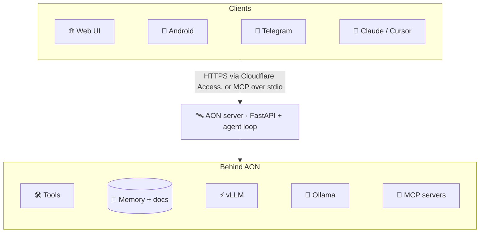

<div align="center">


# 🛰️ AON : Self-Contained Obliterated AI

### Your own uncensored AI agent. One GPU. Zero cloud. Zero filters.

[](https://aon.vulkron.uk)
[](https://www.youtube.com/watch?v=wLiVhkLOd-8)
[](https://pypi.org/project/aon-agent/)
[](#-mcp-server)
[](https://github.com/leo007-htun/AON/releases/latest/download/AON.apk)

[](LICENSE)
[](https://pypi.org/project/aon-agent/)

**[⚡ Quick start](#-quick-start) · [💡 Why AON](#-why-aon) · [🔌 MCP server](#-mcp-server) · [📱 Android](#-android-app) · [🔑 Live instance](#-try-the-live-instance) · [🎬 Demo](#-demo)**

| 💬 Chat | 🗺️ Maps |
|:---:|:---:|
|  |  |

</div>

AON is a self-hosted AI agent that runs on your own hardware with local models. It answers
questions, runs tools (files, shell, web search, maps), remembers you across chats, reads your
documents, and extends itself with new models, skills and MCP servers. Use it from the web, the
Android app, Telegram, or from **Claude Desktop, Claude Code and Cursor through its
[MCP server](#-mcp-server)**.

> [!IMPORTANT]
> 🔒 **Nothing leaves your box.** Chat runs on [vLLM](https://docs.vllm.ai) or
> [Ollama](https://ollama.com) on your own GPU, embeddings on Ollama. No cloud LLM, no API bills,
> no provider filtering or logging.

---

## ⚡ Quick start

```bash
pipx install aon-agent        # 1. install
aon init                      # 2. create ~/.aon with a starter config
aon serve                     # 3. open http://127.0.0.1:8700
```

> [!TIP]
> You need [Ollama](https://ollama.com) with `nomic-embed-text` and a chat model that supports
> tools: `ollama pull nomic-embed-text && ollama pull qwen3:14b`. Then try `aon mcp` to plug AON
> into Claude Desktop ([how](#-mcp-server)).

## 💡 Why AON

Memory and RAG are table stakes now. What AON adds:

- 🔓 **Obliterated and fully yours.** An uncensored ("obliterated") 27B model on a single consumer
  GPU (RTX 4090). Your chats, memory and documents never leave the box.
- 🧬 **It extends itself.** Paste a link and AON works out what it is: a GGUF model it can pull
  (it checks the VRAM budget and tool support first), an MCP server it can connect, a skill repo
  it can import, or docs it can learn from. It can draft a new skill from any web page and test it.
- 🔌 **Plugs into the AI apps you already use.** `aon mcp` turns AON into an MCP server for
  Claude Desktop, Claude Code and Cursor, so they can hand it tasks and search its memory and your
  documents.
- 👥 **A private AI for your whole crew, from one GPU.** vLLM serves several people at once,
  behind Cloudflare Access email PIN, with every user approved by hand.
- 🛡️ **Honest by design.** Shell commands and file writes wait for your approval. A reply that
  claims "done" without a tool having run is not trusted. Secrets are never saved to memory.
- 🗺️ **Grounded, not guessed.** Places and routes come from OpenStreetMap routing on a 3D globe;
  distances and times are computed, not written by the model.

| | 🛰️ **AON** | ☁️ Typical cloud AI chat |
|---|:---:|:---:|
| Runs on your own hardware | ✅ | ❌ |
| Your chats and files stay with you | ✅ | ❌ |
| Provider content filtering | ❌ none | ✅ |
| Cost | your GPU's power | subscription or per token |
| Long-term memory + your documents (RAG) | ✅ | ✅ |
| Runs commands on your server (with your approval) | ✅ | ❌ |
| Installs new models, MCP servers and skills from a link | ✅ | ❌ |
| Usable from Claude Desktop / Cursor as a tool (MCP) | ✅ | ❌ |
| One GPU serves your whole team | ✅ | ❌ |

## 🔌 MCP server

**Use AON inside Claude Desktop, Claude Code, Cursor and any other MCP client.**


`aon mcp` runs AON as a [Model Context Protocol](https://modelcontextprotocol.io) server. It ships
in the [`aon-agent`](https://pypi.org/project/aon-agent/) package
([source](src/aon/mcp_server.py)); your MCP client starts it for you.

| Tool | What it does | Access |
|---|---|:---:|
| `ask_aon` | Hand AON a task or question; it answers with its own model, memory, documents and tools. Pass `chat` to continue a conversation. | ✍️&nbsp;write |
| `search_memory` | Search AON's long-term memory about you | 👀&nbsp;read |
| `remember` | Save a fact to AON's memory | ✍️&nbsp;write |
| `search_documents` | Search your document library by meaning and exact words | 👀&nbsp;read |
| `list_documents` | List the library | 👀&nbsp;read |
| `add_document` | Add a text document to the library | ✍️&nbsp;write |

> [!NOTE]
> Shell commands and file writes are always refused over MCP: there is nobody to approve them
> inside another app.

<details open>
<summary><b>Claude Desktop</b> and <b>Cursor</b></summary>

<br>

- [Claude Desktop](https://modelcontextprotocol.io/docs/develop/connect-local-servers): Settings →
  Developer → Edit Config (`claude_desktop_config.json`), then restart it.
- [Cursor](https://cursor.com/docs/mcp): `~/.cursor/mcp.json`, or `.cursor/mcp.json` in a project.

```json
{
  "mcpServers": {
    "aon": { "command": "aon", "args": ["mcp"] }
  }
}
```

</details>

<details open>
<summary><b>Claude Code</b></summary>

<br>

[Claude Code](https://code.claude.com/docs/en/mcp):

```bash
claude mcp add aon -- aon mcp
```

</details>

Add `"--home", "/path/to/home"` to `args` for a different home folder. If the client can't find
`aon`, use the full path from `which aon`.

## 🎬 Demo

<div align="center">

[](https://www.youtube.com/watch?v=wLiVhkLOd-8)

▶️ *Click to watch on YouTube*

</div>

## ✨ Features

| | |
|---|---|
| 🛠️ **Agent with tools** | Read, write and edit files, run shell commands, search and fetch the web, show maps. Commands and file writes ask for approval. |
| 🧠 **Long memory** | Facts about you, searched by meaning and merged when they change; recall of older turns from this and other chats by meaning and exact strings; a rolling summary plus a numbered outline of everything you asked. |
| 📚 **Document library (RAG)** | Text, code, Markdown, HTML, Word and PDF, from the Documents panel or chat attachments. Hybrid search (SQLite FTS5 + vectors); answers cite the document. |
| 📏 **Context budget** | Every request is fitted to the model's window using the server's exact token count, so long chats never overflow. |
| 🧩 **Skills** | Agent Skills (`SKILL.md`): import from a zip, GitHub URL or pasted text; draft one from a web page; run evals. |
| 🔌 **MCP, both ways** | Connects to stdio and HTTP MCP servers (browse the [Glama directory](https://glama.ai/mcp/servers) in the Hub) and is an [MCP server](#-mcp-server) itself. |
| 📎 **Attachments** | Files and photos in chat; images go to vision models. |
| 🗺️ **Maps** | Places and routes from OpenStreetMap (Nominatim, OSRM) on a MapLibre 3D globe. |
| 👥 **Multi-user** | Chat on vLLM to serve several users at once; Cloudflare Access for sign-in. |
| 📱 **Everywhere** | Web UI, Android app and an optional Telegram bot. |

## 🏗️ Architecture



<details>
<summary><b>Built with</b></summary>

<br>


[](https://modelcontextprotocol.io)


</details>

## 📱 Android app

[](https://github.com/leo007-htun/AON/releases/latest/download/AON.apk)

260 KB, Android 7.0 or newer.

1. Open the link on your phone and download the APK.
2. Allow installs from your browser when Android asks (**Install unknown apps**), then tap **Install**.
3. Open AON and sign in with your approved email address (see [Try the live instance](#-try-the-live-instance)).

The app opens <https://aon.vulkron.uk> by default. To use your own server, press **Back** in the
app and choose **Change server**, for example `http://192.168.1.84:8700` on your home network.
The APK is signed (APK Signature Scheme v2, certificate `CN=AON, O=Vulkron, C=GB`); its SHA-256 is
on the [release page](https://github.com/leo007-htun/AON/releases/latest).

## 🔑 Try the live instance

Access to <https://aon.vulkron.uk> is by approval only:

1. 📝 **Request access.** [Open an issue](https://github.com/leo007-htun/AON/issues/new?title=Access%20request)
   titled *Access request*, saying who you are and what you would like to use AON for. Please do
   **not** post your email address in the issue; the maintainer will reply and tell you how to send it.
2. ⏳ **Wait for approval.** Requests are reviewed by hand. Once yours is approved, your email address
   is added to the allowed list and the issue is closed with a note.
3. ✅ **Sign in.** Open <https://aon.vulkron.uk>, enter the approved email address, and type the
   one-time PIN that is emailed to you. The PIN sign-in is handled by Cloudflare Access.

> [!WARNING]
> Access can be withdrawn at any time. The instance runs on private hardware with limited capacity:
> please do not use it for anything illegal, for automated or bulk traffic, or to process other
> people's personal data, and expect a short wait when several people are using it.

## 📦 Installation

**Requirements**

- Linux (runs on Ubuntu), Python 3.11 or newer.
- [Ollama](https://ollama.com) with an embedding model (`ollama pull nomic-embed-text`) and a chat
  model with tool support (for example `ollama pull qwen3:14b`), unless chat runs on vLLM.
- Optional: a GPU server running vLLM ([`vllm/`](vllm/README.md)).
- Optional: Node.js 20 for `npx`-based MCP servers.

**Install**

```bash
pipx install aon-agent            # or: pip install aon-agent
aon init                          # --ollama URL --model NAME --bind HOST:PORT --home DIR
```

Everything AON keeps (config, chats, memory, documents, skills) lives in its **home folder**:
`--home DIR`, else `$AON_HOME`, else `~/.aon`.

<details>
<summary><b>From source</b> (for development)</summary>

<br>

```bash
git clone https://github.com/leo007-htun/AON.git && cd AON
python3 -m venv venv && venv/bin/pip install -e ".[test]"
venv/bin/aon init
```

</details>

### ⚙️ Configuration

`aon init` writes `config.toml` into the home folder; edit it to taste. Keep `context_window`
equal to vLLM's `--max-model-len` (or the Ollama model's context).

<details>
<summary><b>All <code>config.toml</code> keys</b></summary>

<br>

| Key | Meaning | Example |
|---|---|---|
| `ollama_base_url` | Ollama's OpenAI-compatible endpoint (embeddings, and chat unless `chat_base_url` is set) | `"http://localhost:11434/v1"` |
| `default_model` | Model used when the UI does not pick one | `"qwen3:14b"` |
| `workdir` | The agent's workspace; chats and documents are stored here | `"~/.aon/workspace"` |
| `bind` | Address and port of the web UI | `"0.0.0.0:8700"` |
| `max_steps` | Tool calls allowed per request | `40` |
| `command_timeout` | Seconds before a shell command is stopped | `120` |
| `always_ask` | Extra tools that always need approval | `[]` |
| `embed_model` | Embedding model on Ollama | `"nomic-embed-text"` |
| `context_window` | The chat model's context length, in tokens | `16384` |
| `reply_reserve` | Tokens kept free for thinking and the answer | `6144` |
| `history_tokens` | Recent chat turns sent word for word | `5000` |
| `cross_chat_recall` | Also recall relevant turns from your other chats | `true` |
| `chat_base_url` | Optional separate chat backend (vLLM) | `"http://gpu-box:8001/v1"` |
| `chat_model` | The model name served there; only this model goes to `chat_base_url` | `"aon"` |
| `chat_temperature`, `chat_top_p`, `chat_repetition_penalty` | Sampling for the chat backend | `0.2`, unset, `1.15` |
| `chat_vision` | The chat backend model accepts images | `true` |
| `telegram_bot_token`, `telegram_allowed_chat_ids` | Optional Telegram bot | `""`, `[]` |

</details>

### 🚀 Running

```bash
aon serve                         # web UI on the bind address from config.toml
aon serve --port 9000             # or override host/port
aon --help
```

<details>
<summary><b>In the background</b></summary>

<br>

```bash
setsid nohup aon serve >> ~/.aon/aon.log 2>&1 < /dev/null &
pgrep -af '[a]on serve'           # is it running?
tail -f ~/.aon/aon.log            # its log
pkill -f '[a]on serve'            # stop it
```

</details>

<details>
<summary><b>As a systemd service</b> (starts at boot, restarts on failure)</summary>

<br>

```bash
sudo tee /etc/systemd/system/aon.service >/dev/null <<'EOF'
[Unit]
Description=AON agent
After=network-online.target
Wants=network-online.target

[Service]
User=ubuntu
Environment=AON_HOME=/home/ubuntu/.aon
ExecStart=/home/ubuntu/.local/bin/aon serve
Restart=always
RestartSec=5

[Install]
WantedBy=multi-user.target
EOF
sudo systemctl daemon-reload && sudo systemctl enable --now aon
journalctl -u aon -f
```

Change `User`, `AON_HOME` and the `aon` path (`which aon`) to match your setup.

</details>

### ⚡ Multi-user with vLLM

Ollama answers one request at a time for some models. To serve several users, run the chat
model on vLLM and point AON at it:

```toml
chat_base_url = "http://<gpu-box>:8001/v1"
chat_model = "aon"
default_model = "aon"
context_window = 16384
```

[`vllm/`](vllm/) has the systemd unit, the chat template and the exact package versions used.
Measured on one RTX 4090 (24 GB) with a 27B 4-bit model: 16K context serves 2–3 full-length
requests at once and the rest queue; 8K serves 4.

### 🌐 Remote access

AON has no login of its own. Keep `bind` on your LAN and, to reach it from outside, put it behind
an authenticating proxy, for example a Cloudflare Tunnel with Cloudflare Access (email PIN).
Geolocation in the map needs HTTPS.

## 🧪 Development

```bash
pip install -e ".[test]"
pytest -q
```

<details>
<summary><b>Project layout</b></summary>

<br>

| Path | What it is |
|---|---|
| `src/aon/cli.py` | The `aon` command: `init`, `serve`, `mcp` |
| `src/aon/main.py` | Builds AON from `config.toml` (shared by `serve` and `mcp`) |
| `src/aon/mcp_server.py` | AON as an MCP server |
| `src/aon/web.py` | FastAPI app: REST API and the chat WebSocket |
| `src/aon/engine.py` | The agent loop (tool calls, approval, loop guard) |
| `src/aon/router.py` | Planner: answer directly, ask, or plan tool steps |
| `src/aon/llm_client.py`, `backends.py` | Model calls; Ollama or vLLM per model |
| `src/aon/context.py` | Fitting requests into the context window |
| `src/aon/recall.py`, `summary.py` | Chat recall, rolling summary, outline |
| `src/aon/memory*.py` | Episodic memory, extraction, consolidation |
| `src/aon/docs.py` | Document library (RAG) |
| `src/aon/skills.py`, `skill_*.py` | Skills: store, import, authoring, evals |
| `src/aon/mcp_client.py`, `mcp_tools.py`, `hub.py` | MCP servers and the Glama hub |
| `src/aon/tools/` | Built-in tools (files, shell, web, map) |
| `src/aon/static/` | Web UI (`index.html`), icons, fonts, map library |
| `src/aon/default_skills/` | Skills copied into a new home by `aon init` |
| `tests/` | Test suite |
| `specs/` | Design notes |
| `vllm/` | vLLM server setup |

</details>

## 💾 Data

AON keeps its data in its home folder: `workspace/app.db` (chats), `workspace/docs.db` (document
library), `memory/episodes.db` (memory) and `workspace/uploads/` (attachments). This repository
includes a snapshot of them from 2026-10-14. A fresh install creates empty ones; to start clean,
delete them before the first run. The Glama API key is kept in `.glama_key`, which is git-ignored.

## 🤝 Contributing

Issues and pull requests are welcome. For anything bigger than a fix, please
[open an issue](https://github.com/leo007-htun/AON/issues) first to talk it through. Run
`pytest -q` before sending a pull request.

## 📄 License

AON is released under the [MIT License](LICENSE). © 2026 Sithu Htun ([@leo007-htun](https://github.com/leo007-htun)).

Bundled third-party files keep their own licenses, included next to them:
[CybercoreCSS](src/aon/static/lib/cybercore.LICENSE) (MIT),
[MapLibre GL JS](src/aon/static/lib/maplibre-gl.LICENSE) (BSD-3-Clause),
highlight.js (BSD-3-Clause), and the Exo 2, JetBrains Mono, Orbitron and Rajdhani fonts
([SIL Open Font License](src/aon/static/fonts/)).

---

<div align="center">

**If AON is useful to you, give it a ⭐. It helps others find it.**

[⬆ Back to top](#top)

</div>
